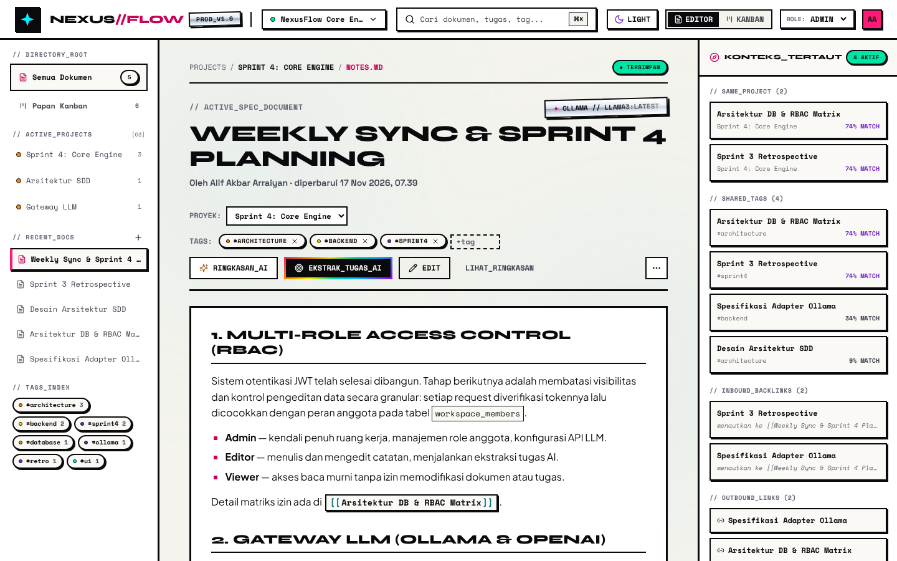
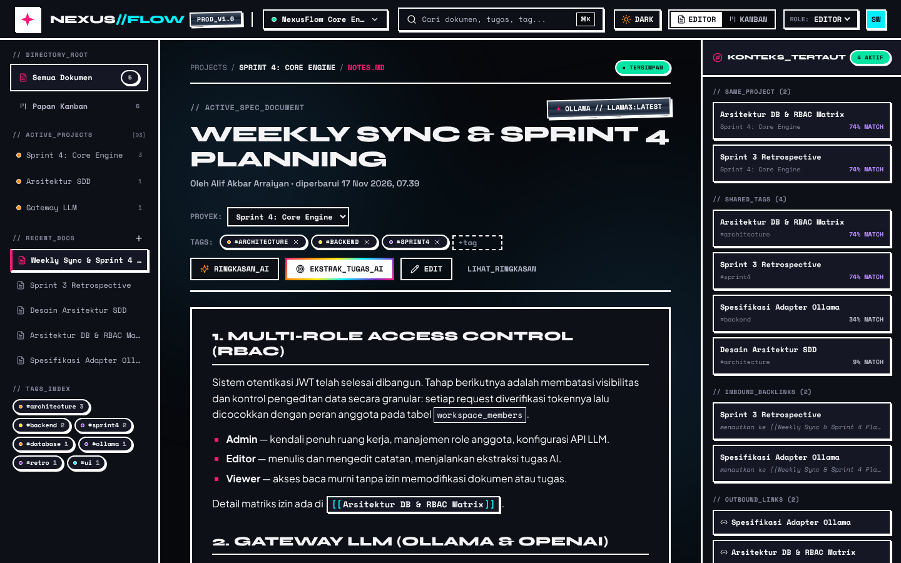
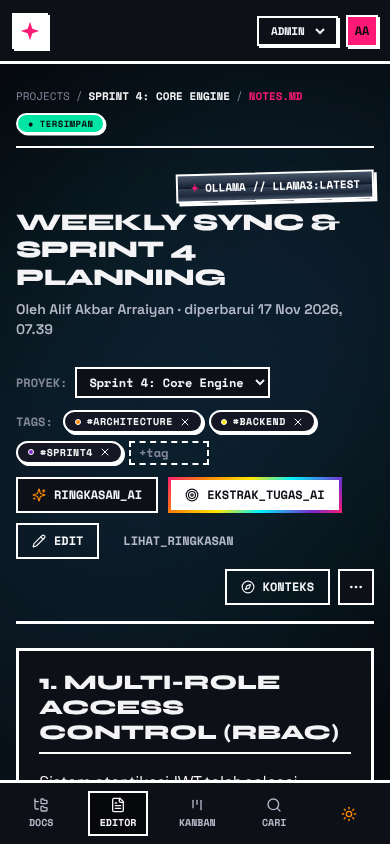
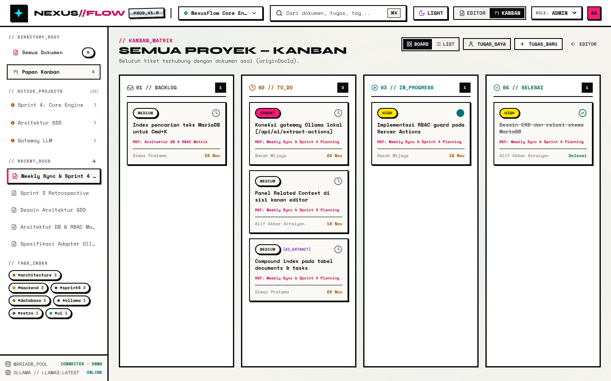
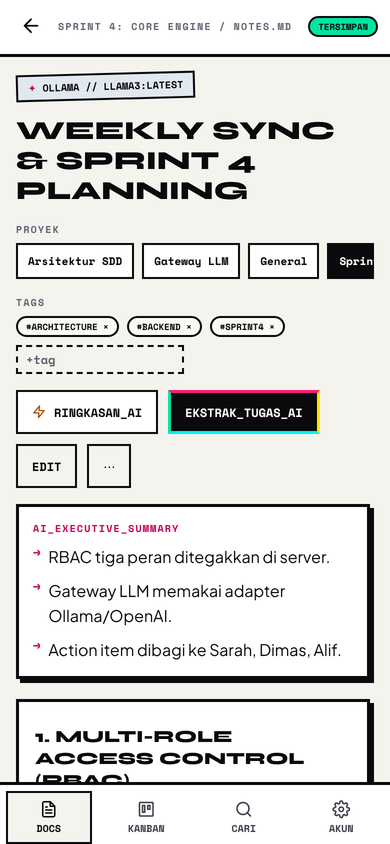
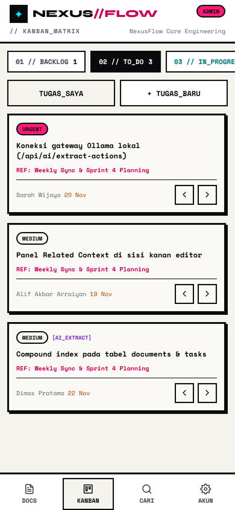
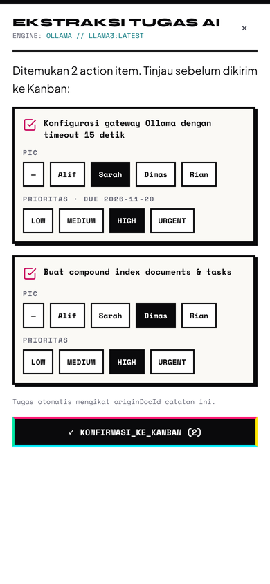

# NexusFlow — Unified Context-Aware Workspace

> **Tugas Besar (TuBes) — Pemrograman Lanjut**
> **Penyusun / Mahasiswa**: Alif Akbar Arraiyan (NIM: 101032330121)
> **Stack**: Next.js 15 (App Router) · React 19 · MariaDB 11.4 · Drizzle ORM · Expo SDK 58 (React Native)

---

## 1. Deskripsi Aplikasi

**NexusFlow** adalah ruang kerja terpadu yang menggabungkan catatan Markdown dan papan Kanban untuk *knowledge workers*.
Terdiri dari dua klien yang memakai server dan basis data yang sama:

- **Web app** (Next.js) — tata letak 3 panel (direktori · editor/Kanban · konteks terkait), responsif hingga 375px.
- **Mobile app** (Expo / React Native, folder [`mobile/`](mobile/README.md)) — aplikasi native Android & iOS lewat REST API.

Fitur utama (mengacu PRD, SDD, DFD, dan spesifikasi desain):

| Modul | Implementasi |
| :--- | :--- |
| **Autentikasi** | Registrasi & login (bcrypt 12 rounds), JWT access 2 jam + refresh 7 hari (cookie httpOnly untuk web, Bearer untuk mobile), logout mencabut semua token, rate-limit login. |
| **RBAC** | Admin / Editor / Viewer per workspace, **ditegakkan di server** pada setiap Server Action & endpoint REST (Viewer → HTTP 403). Selector peran di navbar hanya bisa *menurunkan* izin (pratinjau). |
| **Catatan** | CRUD Markdown, autosave 3 detik, proyek, tag, arsip (soft delete) & hapus permanen (Editor hanya milik sendiri), `[[wikilink]]` dua arah yang otomatis membentuk backlink. |
| **Tugas** | CRUD tugas dengan assignee, tenggat, prioritas, status, dokumen asal; Kanban 4 kolom dengan *drag-and-drop*, tampilan List, filter proyek & "tugas saya". |
| **Related Context** | Skor relevansi SDD §6.1: `0.40·proyek + 0.35·Jaccard(tag) + 0.25·tautan`, backlink/outbound, tugas aktif — diperbarui real-time saat dokumen disimpan. |
| **AI** | Adapter Ollama (`/api/generate`) & OpenAI (`/chat/completions`), konfigurasi per workspace oleh Admin (API key terenkripsi AES-256-GCM), timeout 15 detik, banner error + coba lagi. Ringkasan (bisa disisipkan / untuk teks terpilih) dan ekstraksi action item → review → batch ke Kanban (`extractedByAi`). |
| **Pencarian** | Cmd/Ctrl+K: catatan, tugas, tag, proyek; filter tipe, tag, status; hanya dalam workspace yang diikuti. |
| **Desain** | *Artistic Clash* (Neo-Brutalism × Y2K × Holographic × Dreamcore), tema Light/Dark tanpa kedip, seluruh pasangan teks lolos WCAG AA (`node scripts/verify_contrast.js`). |

---

## 2. Screenshot

| Desktop Light | Desktop Dark |
| :---: | :---: |
|  |  |

| Mobile Web | Kanban |
| :---: | :---: |
|  |  |

| App Native — Dokumen | App Native — Kanban | App Native — Ekstraksi AI |
| :---: | :---: | :---: |
|  |  |  |

---

## 3. Prasyarat

- **Bun** v1.1+ (atau Node.js 18.18+)
- **Docker** & Docker Compose untuk MariaDB (atau MariaDB/MySQL lokal)
- Opsional: **Ollama** (`ollama run llama3`) atau API key OpenAI untuk fitur AI
- Mobile: **Expo Go** di HP, atau emulator Android / simulator iOS

---

## 4. Menjalankan Web App

```bash
cp .env.example .env              # isi AUTH_SECRET (openssl rand -base64 32)
bun install
docker compose up -d              # MariaDB 11.4 (container: nexusflow_mariadb)
bun run db:migrate                # atau: bun run db:push
bun run db:seed                   # data demo (aman dijalankan ulang; --reset untuk membangun ulang)
bun run dev                       # http://localhost:3000
```

Produksi: `bun run build && bun run start`. Di produksi `AUTH_SECRET` wajib dan cookie memakai flag `Secure` (HTTPS).

> **Upgrade dari versi lama:** skema berubah total (8 tabel sesuai `DATABASE_RELATIONS.md`, ditambah auth & konfigurasi LLM).
> Database lama hanya berisi data demo — reset dengan `docker compose down -v`, lalu ulangi migrate & seed.
> Jika port 3306 sudah dipakai MariaDB lokal, ubah `DB_PORT` di `.env`.

### Akun demo (setelah `db:seed`, password `nexusflow123`)

| Email | Peran |
| :--- | :--- |
| `alif@nexusflow.dev` | Admin (owner) |
| `sarah@nexusflow.dev` | Editor |
| `dimas@nexusflow.dev` | Editor |
| `rian@nexusflow.dev` | Viewer |

Akun baru dari halaman registrasi otomatis mendapat workspace sendiri (sebagai Admin). Admin mengundang akun terdaftar lewat **Pengaturan → Anggota & Role**.

## 5. Menjalankan Mobile App

```bash
cd mobile && bun install && bun run start
```
Di layar login, isi alamat server (emulator Android: `http://10.0.2.2:3000`, HP fisik: IP LAN komputer dengan `bun run dev -H 0.0.0.0`). Detail di [`mobile/README.md`](mobile/README.md).

---

## 6. Environment Variables

| Variabel | Contoh | Keterangan |
| :--- | :--- | :--- |
| `DB_HOST` / `DB_PORT` | `localhost` / `3306` | Koneksi MariaDB |
| `DB_USER` / `DB_PASSWORD` / `DB_NAME` | `nexus_user` / … / `nexusflow_db` | Kredensial aplikasi |
| `DB_ROOT_PASSWORD` | `nexus_root_secret` | Hanya untuk container Docker |
| `DATABASE_URL` | `mysql://…/nexusflow_db` | Dipakai `drizzle-kit` |
| `AUTH_SECRET` | hasil `openssl rand -base64 32` | Tanda tangan JWT & enkripsi API key LLM (**wajib di produksi**) |
| `OLLAMA_BASE_URL` / `OLLAMA_MODEL` | `http://localhost:11434` / `llama3:latest` | Default engine AI (dapat dioverride Admin per workspace) |
| `EXPO_PUBLIC_API_URL` | `http://10.0.2.2:3000` | (mobile) default alamat server |

---

## 7. Arsitektur

```
src/
├── actions/index.ts        # Server Actions (controller web) — Zod → service
├── app/
│   ├── api/**/route.ts     # REST API (controller mobile/klien eksternal) — Zod → service
│   ├── login, register     # Halaman autentikasi
│   └── w/[slug]/           # Workspace (3 panel) & /settings
├── services/               # Logika bisnis + RBAC (Controller-Service-Repository)
│   ├── access.ts           #   requireMember(): guard peran (SDD 6.3)
│   ├── documents.ts        #   catatan, tag, wikilink, Related Context
│   ├── tasks.ts · search.ts · workspaces.ts · auth.ts · ai.ts
├── lib/
│   ├── domain.ts           # Konstanta & DTO bersama
│   ├── ai.ts               # Gateway LLM: adapter Ollama/OpenAI + validasi output
│   ├── context.ts          # Algoritma skor relevansi (murni, teruji)
│   ├── auth.ts · tokens.ts · password.ts · crypto.ts · markdown.ts · http.ts
│   └── validations/        # Skema Zod
├── db/                     # Skema Drizzle (8 tabel), migrasi, seed idempoten
├── middleware.ts           # Refresh token senyap + CORS untuk /api
└── components/             # UI (shadcn/ui & Magic UI yang di-restyle)
mobile/                     # Aplikasi Expo Router (lihat mobile/README.md)
```

### REST API (ringkas)

Semua endpoint (kecuali auth & health) memerlukan `Authorization: Bearer <token>` atau cookie sesi.

| Method & Path | Peran minimum |
| :--- | :--- |
| `POST /api/auth/register` · `login` · `refresh` · `logout` | — |
| `GET /api/me` · `GET/POST /api/workspaces` | login |
| `GET /api/workspaces/:id` (snapshot) · `PATCH` · `DELETE` | Viewer · Admin · Admin |
| `GET/POST /api/workspaces/:id/members` · `PATCH/DELETE …/members/:memberId` | Viewer/Admin · Admin |
| `GET/PUT /api/workspaces/:id/llm` · `PATCH /api/workspaces/:id/projects` | Admin |
| `GET/POST /api/workspaces/:id/documents` · `GET/PUT/DELETE /api/documents/:id` | Viewer/Editor |
| `GET /api/documents/:id/related-context` | Viewer |
| `GET/POST /api/workspaces/:id/tasks` · `POST …/tasks/batch` | Viewer/Editor |
| `PUT/DELETE /api/tasks/:id` · `PATCH /api/tasks/:id/status` | Editor |
| `POST /api/ai/summarize` · `POST /api/ai/extract-actions` · `GET /api/ai/status` | Editor · Editor · Viewer |
| `GET /api/workspaces/:id/search?q=&type=&tag=&status=` | Viewer |
| `GET /api/health` | — |

---

## 8. Pengujian

```bash
bun run typecheck                                   # TypeScript strict
bun run test                                        # unit test: wikilink, skor konteks, normalisasi AI, RBAC
BASE_URL=http://localhost:3000 bun run test:api     # 25 uji end-to-end REST (butuh server + seed)
node scripts/verify_contrast.js                     # audit kontras WCAG (52 pasangan)
cd mobile && bun run typecheck && bun run test      # mobile
```
